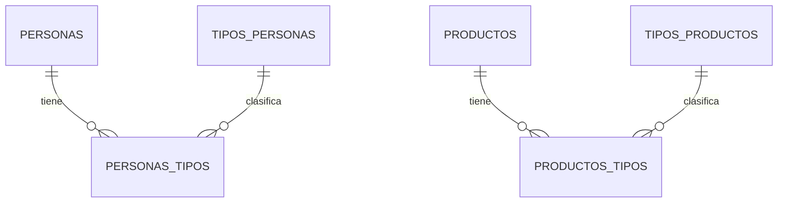

# Personas, clientes y productos

Esta guía describe los dos módulos administrativos incorporados al sistema: **Personas** y **Productos**. Ambos se administran desde la web y solo están disponibles para usuarios con el rol `Administrador`.

> En la interfaz, un cliente es una persona cuyo tipo incluye `Cliente`. La misma persona también puede ser, por ejemplo, proveedor o funcionario.

## Modelo de relaciones

Los dos módulos usan una relación **muchos a muchos (N:M)** con sus tipos. Esto evita obligar a que una persona o un producto tenga un único tipo.



Ejemplos:

- Una persona puede ser simultáneamente `Cliente` y `Proveedor`.
- Un registro de catálogo puede ser `Producto` e `Insumo` si el negocio necesita clasificarlo de ambas formas.

Las tablas puente `personas_tipos` y `productos_tipos` son las que guardan esas asociaciones. Sus claves primarias son compuestas, por lo que una misma relación no puede repetirse.

## Módulo Personas / Clientes

### Tabla `personas`

| Campo | Tipo | Regla | Explicación |
|---|---|---|---|
| `Id_Personas` | entero | PK, autoincremental | Identificador único de la persona. |
| `Nombre` | varchar(150) | obligatorio | Nombre completo o razón de identificación de la persona. |
| `Documento` | varchar(50) | obligatorio, único | Documento de identidad o RUC. No se permiten duplicados. |
| `Telefono` | varchar(30) | opcional | Teléfono de contacto. |
| `Activo` | boolean | obligatorio, valor inicial `true` | Permite desactivar el registro sin eliminarlo. |

### Tabla `tipos_personas`

| Campo | Tipo | Regla | Explicación |
|---|---|---|---|
| `Id_Tipos_Personas` | entero | PK, autoincremental | Identificador del tipo. |
| `Descripcion` | varchar(100) | obligatorio, único | Nombre del tipo de persona. |

Los tipos iniciales cargados por la migración son: `Cliente`, `Funcionario` y `Proveedor`.

### Tabla puente `personas_tipos`

| Campo | Tipo | Regla |
|---|---|---|
| `Id_Personas` | entero | FK a `personas`, eliminación en cascada. |
| `Id_Tipos_Personas` | entero | FK a `tipos_personas`, eliminación restringida. |

No se puede eliminar un tipo de persona mientras esté asignado a una o más personas. Al eliminar una persona, sus vínculos de tipo se eliminan automáticamente.

### Reglas funcionales

- Nombre y documento son obligatorios.
- Debe seleccionarse al menos un tipo.
- El documento es único.
- Se puede crear, editar, activar/desactivar y eliminar una persona.
- La pantalla muestra los campos verticalmente, con etiquetas para facilitar su carga.

### API

Todas las rutas requieren token JWT y rol `Administrador`.

| Método | Ruta | Acción |
|---|---|---|
| `GET` | `/api/personas` | Lista personas y sus tipos. |
| `POST` | `/api/personas` | Crea una persona. |
| `PUT` | `/api/personas/{id}` | Edita una persona. |
| `PATCH` | `/api/personas/{id}/estado` | Activa o desactiva una persona. |
| `DELETE` | `/api/personas/{id}` | Elimina una persona. |
| `GET/POST` | `/api/tipos-personas` | Lista o crea tipos. |
| `PUT/DELETE` | `/api/tipos-personas/{id}` | Edita o elimina un tipo sin uso. |

Ejemplo de creación:

```json
{
  "nombre": "Ana Gómez",
  "documento": "1234567",
  "telefono": "0981 000 000",
  "id_Tipos_Personas": [1]
}
```

## Módulo Productos

### Tabla `productos`

| Campo | Tipo | Regla | Explicación |
|---|---|---|---|
| `Id_Productos` | entero | PK, autoincremental | Identificador único del producto o servicio. |
| `Descripcion` | varchar(150) | obligatorio, único | Nombre o descripción del registro. |
| `PrecioDeCosto` | numeric(18,0) | obligatorio, no negativo | Costo de adquisición o prestación en guaraníes enteros. |
| `PrecioDeVenta` | numeric(18,0) | obligatorio, no negativo | Precio que se cobra al cliente, en guaraníes enteros. |
| `Activo` | boolean | obligatorio, valor inicial `true` | Permite activar o desactivar el producto sin eliminarlo. |
| `StockActual` | numeric(18,0) | obligatorio, valor inicial `0`, no negativo | Existencia actual disponible, sin fracciones. |

La interfaz y la API aceptan únicamente valores enteros. La base de datos utiliza `numeric(18,0)` para reflejar que los importes se manejan exclusivamente en guaraníes, sin decimales.

### Tabla `tipos_productos`

| Campo | Tipo | Regla | Explicación |
|---|---|---|---|
| `Id_Tipos_Productos` | entero | PK, autoincremental | Identificador del tipo. |
| `Descripcion` | varchar(100) | obligatorio, único | Nombre del tipo de producto. |

Los tipos iniciales son: `Servicio`, `Producto` e `Insumo`.

### Tabla puente `productos_tipos`

| Campo | Tipo | Regla |
|---|---|---|
| `Id_Productos` | entero | FK a `productos`, eliminación en cascada. |
| `Id_Tipos_Productos` | entero | FK a `tipos_productos`, eliminación restringida. |

No se puede eliminar un tipo que esté asignado a productos. Al eliminar un producto, se eliminan automáticamente sus relaciones de tipo.

### Reglas funcionales

- Descripción y al menos un tipo son obligatorios.
- La descripción es única.
- Costo, venta y stock no aceptan valores negativos.
- Se puede crear, editar, activar/desactivar y eliminar productos.
- El selector de tipos es un desplegable visual que permite seleccionar uno o varios tipos.
- Los campos del formulario se muestran verticalmente y con etiquetas.

### API

Todas las rutas requieren token JWT y rol `Administrador`.

| Método | Ruta | Acción |
|---|---|---|
| `GET` | `/api/productos` | Lista productos y sus tipos. |
| `POST` | `/api/productos` | Crea un producto. |
| `PUT` | `/api/productos/{id}` | Edita un producto. |
| `PATCH` | `/api/productos/{id}/estado` | Activa o desactiva un producto. |
| `DELETE` | `/api/productos/{id}` | Elimina un producto. |
| `GET/POST` | `/api/tipos-productos` | Lista o crea tipos. |
| `PUT/DELETE` | `/api/tipos-productos/{id}` | Edita o elimina un tipo sin uso. |

Ejemplo de creación:

```json
{
  "descripcion": "Lavado completo",
  "precioDeCosto": 25000,
  "precioDeVenta": 50000,
  "stockActual": 0,
  "id_Tipos_Productos": [1]
}
```

## Migraciones de Supabase

Las tablas están definidas en migraciones versionadas, aplicadas en el proyecto Supabase:

- `20261025100000_crear_personas_y_tipos.sql`
- `20261025110000_crear_productos_y_tipos.sql`
- `20261026100000_productos_sin_decimales.sql`

La web nunca se conecta directamente a Supabase: consume la API ASP.NET Core, que usa Entity Framework Core y PostgreSQL.
